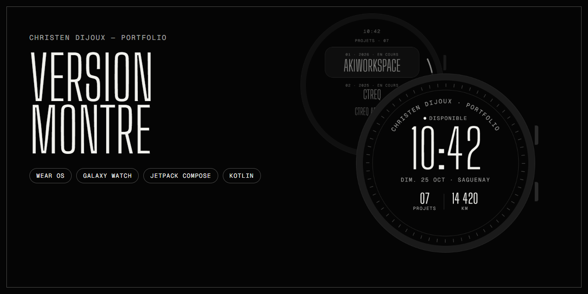
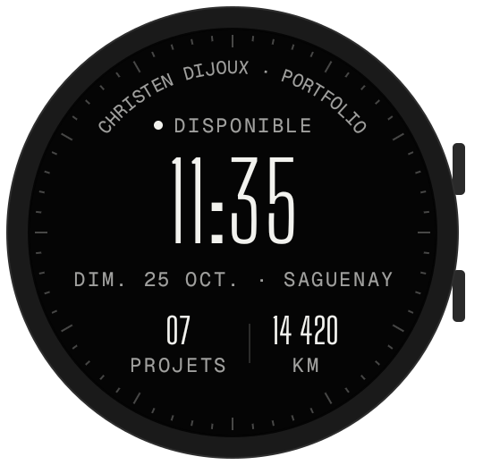
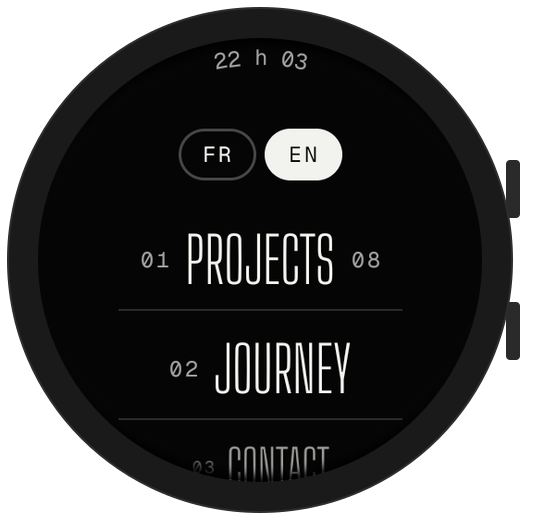
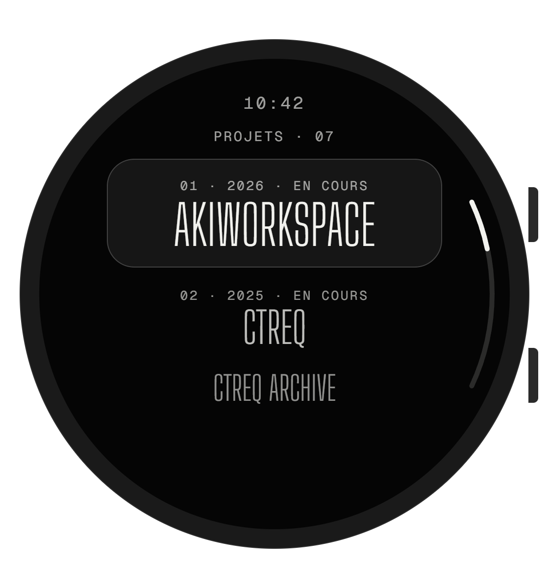
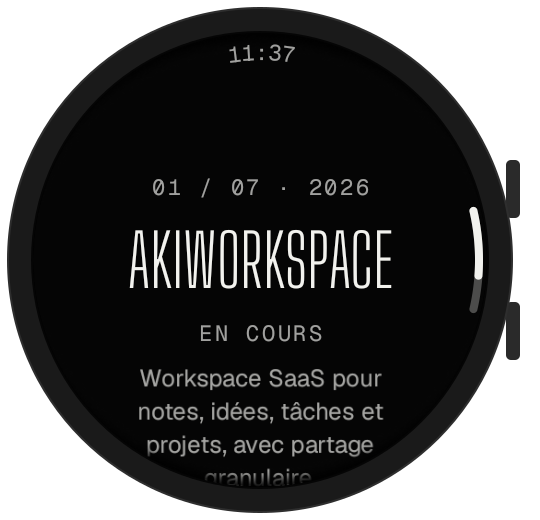
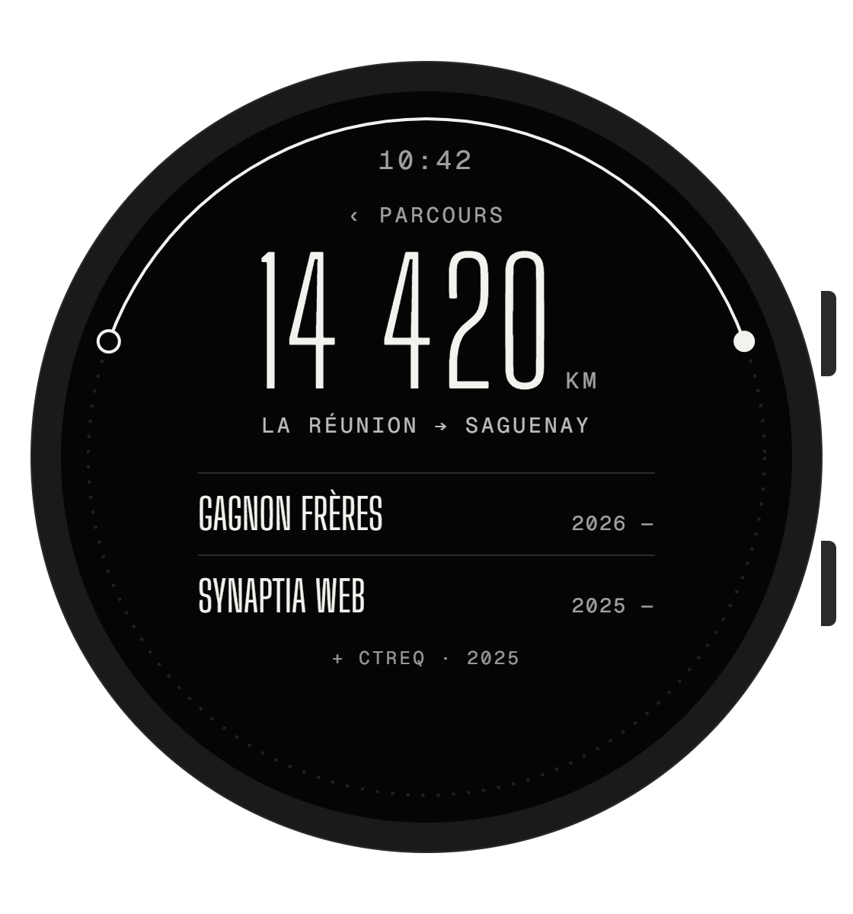
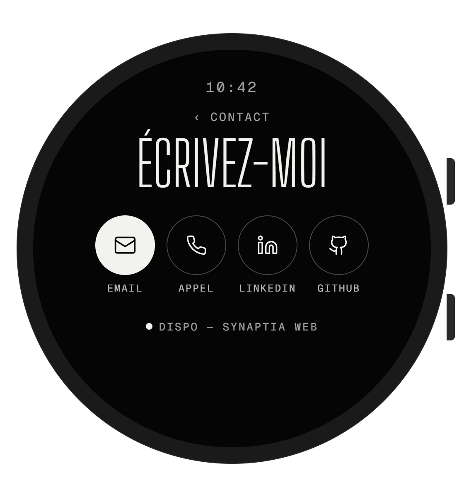
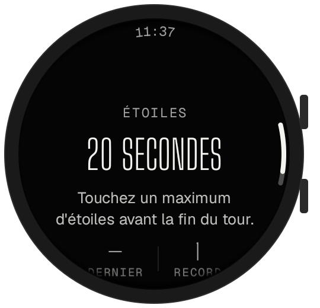
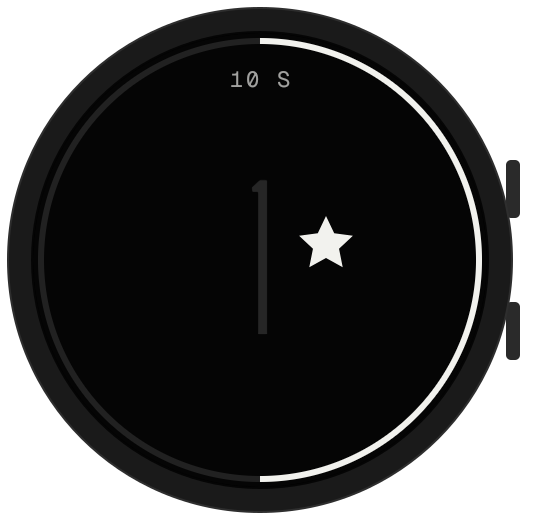

<p align="center">
  
</p>

<p align="center">
  <a href="https://github.com/Akiyo974/portfolio-watch/actions/workflows/android.yml"></a>
  <a href="https://github.com/Akiyo974/portfolio-watch/releases/latest"></a>
  
  
  
  
</p>

<p align="center">
  <a href="https://christendijoux.com"><b>christendijoux.com</b></a> ·
  <a href="#aperçu">Aperçu</a> ·
  <a href="#installer-lapp">Installer</a> ·
  <a href="#développement">Développement</a> ·
  <a href="#feuille-de-route">Feuille de route</a>
</p>

---

Mon [portfolio](https://christendijoux.com), repensé pour un écran rond d'un pouce et demi.
Une app **Wear OS** pensée pour la **Samsung Galaxy Watch** : mes projets, mon parcours et un moyen de me joindre, au poignet, en trois touches au plus.

Elle reprend l'identité du site — monochrome, éditoriale, typographie condensée — et l'adapte aux codes de Wear OS : heure en haut qui s'efface au défilement, listes qui suivent la courbe de l'écran, défilement à la lunette, retour en glissant vers la droite.

## Aperçu

<table>
  <tr>
    <td align="center"><br><sub><b>Accueil</b><br>Heure en direct, projets, km</sub></td>
    <td align="center"><br><sub><b>Menu</b><br>Navigation numérotée</sub></td>
    <td align="center"><br><sub><b>Projets</b><br>Les 7 projets du portfolio</sub></td>
    <td align="center"><br><sub><b>Étude de cas</b><br>Résumé, ouverture sur le téléphone</sub></td>
  </tr>
  <tr>
    <td align="center"><br><sub><b>Parcours</b><br>La Réunion → Saguenay</sub></td>
    <td align="center"><br><sub><b>Contact</b><br>E-mail, appel, LinkedIn, GitHub</sub></td>
    <td align="center"><br><sub><b>Jeu des étoiles</b><br>Dernier score et record</sub></td>
    <td align="center"><br><sub><b>Partie en cours</b><br>20 s, anneau de temps</sub></td>
  </tr>
</table>

<sub>Captures de l'app réelle dans l'émulateur Wear OS 5 (Large Round, 454 px). Les maquettes de conception d'origine sont dans <a href="docs/design">docs/design</a>.</sub>

## Fonctionnalités

- **Accueil façon cadran** — heure et date en direct, graduation des minutes, nom écrit le long du bord, disponibilité et deux complications. Un toucher ouvre le menu.
- **Projets** — les sept projets du portfolio avec année et statut ; chaque étude de cas s'**ouvre en entier sur le téléphone** associé.
- **Parcours** — 14 420 km de La Réunion à Saguenay, tracés le long de la lunette, puis les expériences récentes.
- **Contact** — e-mail, appel, LinkedIn et GitHub en un toucher. L'appel part de la montre si elle le permet, sinon du téléphone.
- **Jeu des étoiles** — le clin d'œil caché du site : un maximum d'étoiles en 20 secondes, avec vibration à chaque touche et record gardé sur la montre.
- **Autonome** — aucune app compagnon à installer sur le téléphone.

## Installer l'app

### Depuis une release

1. Téléchargez `portfolio-watch-v*.apk` depuis la [dernière release](https://github.com/Akiyo974/portfolio-watch/releases/latest).
2. Sur la montre : *Paramètres → À propos de la montre → Informations sur le logiciel*, touchez 5 fois **Version du logiciel** pour activer le mode développeur.
3. *Paramètres → Options de développement* : activez **Débogage ADB** et **Débogage sans fil**, puis notez l'adresse IP et les ports affichés.
4. Depuis l'ordinateur, sur le même réseau Wi-Fi :

```bash
adb pair <IP>:<PORT_D_APPAIRAGE>
adb connect <IP>:<PORT>
adb install -r portfolio-watch-v0.2.0.apk
```

`-r` met à jour l'app déjà installée en gardant ses données. Depuis la v0.2.0, les releases sont signées avec la même clé : les mises à jour s'installent par-dessus. Pour passer de la v0.1.0 (ou d'un APK de debug) à une release, désinstallez une fois l'ancienne version (`adb uninstall com.christendijoux.watch`).

### Depuis la CI

Chaque push sur `main` compile l'app : l'APK de debug est téléchargeable dans les artefacts du [dernier build](https://github.com/Akiyo974/portfolio-watch/actions/workflows/android.yml). Il est signé avec une clé de debug qui change d'un build à l'autre : il faut désinstaller l'app avant de l'installer.

## Développement

### Prérequis

- JDK 17
- SDK Android (plateforme 35) — via [Android Studio](https://developer.android.com/studio) ou les outils en ligne de commande
- Une Galaxy Watch sous Wear OS 3+ **ou** l'émulateur *Wear OS Large Round*

### Compiler et lancer

```bash
git clone https://github.com/Akiyo974/portfolio-watch.git
cd portfolio-watch
./gradlew assembleDebug      # APK dans app/build/outputs/apk/debug/
./gradlew installDebug       # installe sur la montre ou l'émulateur connecté
./gradlew lintDebug          # analyse statique Android
```

Sans Android Studio, indiquez l'emplacement du SDK dans un fichier `local.properties` (non versionné) :

```properties
sdk.dir=C:/Users/<vous>/Android/Sdk
```

### Publier une release

1. Mettre à jour `versionCode` et `versionName` dans `app/build.gradle.kts`, et la section correspondante du [CHANGELOG](CHANGELOG.md).
2. Une fois sur `main`, pousser le tag de la version :

```bash
git tag v0.2.0
git push origin v0.2.0
```

Le workflow [Release](.github/workflows/release.yml) vérifie que le tag correspond à `versionName`, compile l'APK signé, puis publie la release avec ses notes tirées du CHANGELOG.

La signature utilise une clé PKCS12 fixe (alias `portfolio-watch`), jamais versionnée, fournie par deux secrets du dépôt (*Settings → Secrets and variables → Actions*) :

| Secret | Contenu |
|---|---|
| `SIGNING_KEYSTORE_BASE64` | Le fichier `.p12` encodé en base64 |
| `SIGNING_PASSWORD` | Son mot de passe |

Pour signer en local, définir `SIGNING_STORE_FILE`, `SIGNING_STORE_PASSWORD`, `SIGNING_KEY_ALIAS` et `SIGNING_KEY_PASSWORD` avant `./gradlew assembleRelease`. Sans ces variables, l'APK de release est produit non signé.

### Stack technique

| Couche | Choix |
|---|---|
| Langage | Kotlin 2.1 |
| Interface | Jetpack Compose for Wear OS 1.4 (`compose-material`, `compose-foundation`) |
| Navigation | `SwipeDismissableNavHost` : glisser vers la droite ou bouton retour |
| Listes | `ScalingLazyColumn`, défilement à la lunette, `PositionIndicator` courbe |
| Ouverture sur téléphone | `RemoteActivityHelper` (`androidx.wear:wear-remote-interactions`) |
| Carte de visite | QR code vCard généré sur la montre ([ZXing](https://github.com/zxing/zxing)) |
| Polices | Big Shoulders Display, Geist, Geist Mono — fichiers variables embarqués |
| Build | Gradle 8.11 · AGP 8.7 · JDK 17 · GitHub Actions |
| Cible | Wear OS 3+ (API 30 à 35), Galaxy Watch 4 et modèles plus récents |

### Structure

```text
portfolio-watch/
├── app/src/main/
│   ├── java/com/christendijoux/watch/
│   │   ├── MainActivity.kt
│   │   ├── data/Portfolio.kt         # Projets, parcours, liens (repris du site)
│   │   ├── data/ContactCard.kt       # Carte de visite vCard et QR code
│   │   ├── util/Phone.kt             # Ouverture sur le téléphone, appel
│   │   ├── util/Clock.kt             # Heure mise à jour à chaque minute
│   │   └── ui/
│   │       ├── WearApp.kt            # Navigation entre les écrans
│   │       ├── theme/Theme.kt        # Couleurs, polices, styles de texte
│   │       ├── components/           # Étiquettes, boutons, icônes
│   │       └── screens/              # Accueil, Menu, Projets, Projet, Parcours, Contact, QR, Jeu
│   └── res/                          # Polices, icône, thème, textes EN (values) et FR (values-fr)
├── .github/workflows/android.yml     # Build, lint et APK à chaque push
├── .github/workflows/release.yml     # APK signé et release à chaque tag v*
├── docs/
│   ├── screens/                      # Captures de l'app
│   └── design/                       # Maquettes de conception
└── third_party/fonts/                # Licences OFL des polices
```

### Design

| | |
|---|---|
| **Couleurs** | Encre `#050505` · Papier `#F2F2EE` · Lignes à 16–28 % d'opacité |
| **Typographies** | [Big Shoulders Display](https://fonts.google.com/specimen/Big+Shoulders+Display) (titres) · [Geist](https://vercel.com/font) (texte) · Geist Mono (étiquettes) |
| **Principes** | Contenu dans la zone sûre centrale, cibles tactiles ≥ 48 dp, texte qui suit la courbe de l'écran |

## Feuille de route

- [x] Maquettes des écrans (format rond)
- [x] App Wear OS : accueil, menu, projets, étude de cas, parcours, contact, jeu
- [x] Ouverture des liens sur le téléphone
- [x] Tests dans l'émulateur Wear OS 5 et captures réelles
- [x] Intégration continue (build, lint, APK)
- [x] Carte de visite en QR code
- [x] Version anglaise
- [x] Releases signées publiées automatiquement
- [ ] Test sur une vraie Galaxy Watch (lunette tournante, téléphone associé)
- [ ] Cadran installable (Watch Face Format)
- [ ] Tuile Wear OS « Disponibilité »
- [ ] Publication sur le Google Play Store

Les évolutions sont détaillées dans le [CHANGELOG](CHANGELOG.md).

## Liens

- Portfolio web : [christendijoux.com](https://christendijoux.com) — code : [Akiyo974/portfolio](https://github.com/Akiyo974/portfolio)
- LinkedIn : [christen-dijoux](https://www.linkedin.com/in/christen-dijoux)

## Licence

Code distribué sous licence [MIT](LICENSE). © 2026 Christen Dijoux.

Polices sous [SIL Open Font License](third_party/fonts) : Big Shoulders Display (The Big Shoulders Project Authors), Geist et Geist Mono (The Geist Project Authors). Icônes d'après [Lucide](https://lucide.dev) (ISC).
