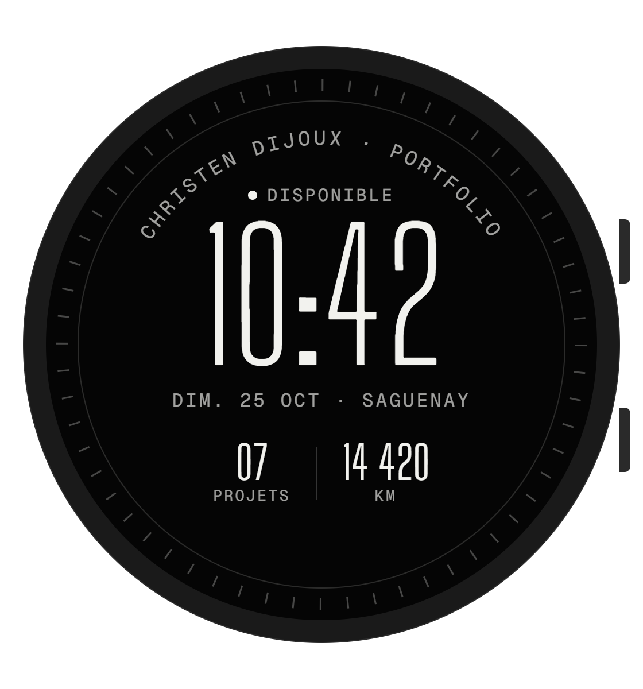
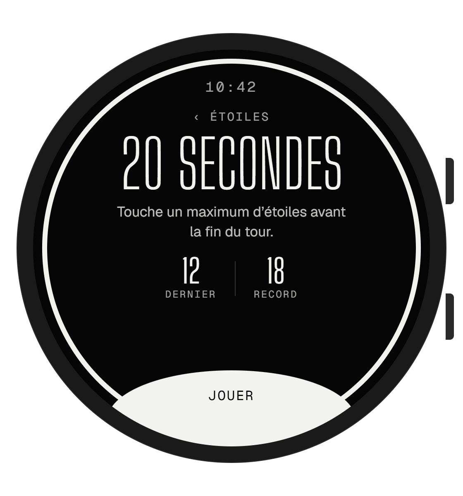
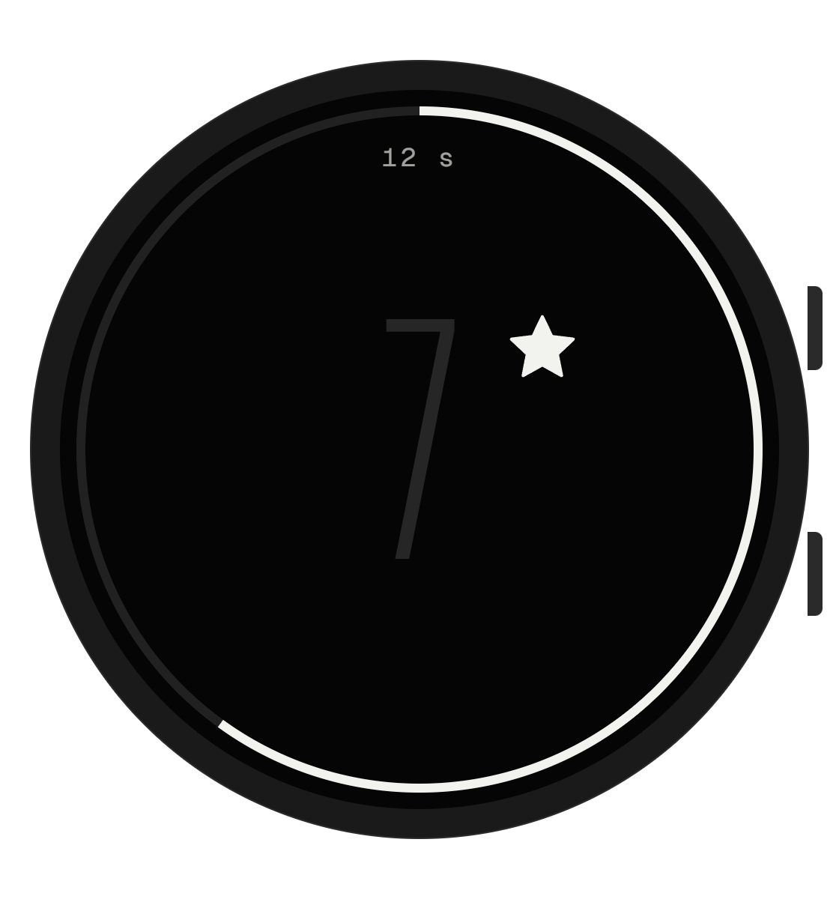

<p align="center">
  
</p>

<p align="center">
  
  
  
  
  
  
</p>

<p align="center">
  <a href="https://christendijoux.com"><b>christendijoux.com</b></a> ·
  <a href="https://github.com/Akiyo974/portfolio">Portfolio web</a> ·
  <a href="#aperçu">Aperçu</a> ·
  <a href="#démarrage">Démarrage</a> ·
  <a href="#feuille-de-route">Feuille de route</a>
</p>

---

Mon [portfolio](https://christendijoux.com), repensé pour un écran rond de 1,4 pouce.
Une app **Wear OS** pensée d'abord pour la **Samsung Galaxy Watch** : mes projets, mon parcours et un moyen de me joindre, au poignet, en trois touches maximum.

Elle reprend l'identité du site — monochrome, éditoriale, typographie condensée — et l'adapte aux codes de Wear OS : heure en haut, listes centrées qui suivent la courbe de l'écran, bouton principal collé au bord, défilement à la lunette.

## Aperçu

<table>
  <tr>
    <td align="center"><br><sub><b>Cadran</b><br>Heure, disponibilité, projets et km</sub></td>
    <td align="center"><br><sub><b>Menu</b><br>Navigation numérotée</sub></td>
    <td align="center"><br><sub><b>Projets</b><br>Liste qui s'agrandit au centre</sub></td>
    <td align="center"><br><sub><b>Étude de cas</b><br>Résumé et ouverture sur le téléphone</sub></td>
  </tr>
  <tr>
    <td align="center"><br><sub><b>Parcours</b><br>La Réunion → Saguenay, 14 420 km</sub></td>
    <td align="center"><br><sub><b>Contact</b><br>E-mail, appel, LinkedIn, GitHub</sub></td>
    <td align="center"><br><sub><b>Jeu des étoiles</b><br>Dernier score et record</sub></td>
    <td align="center"><br><sub><b>Partie en cours</b><br>20 s, anneau de temps</sub></td>
  </tr>
</table>

> Ces images sont les maquettes de conception. Les captures de l'app réelle les remplaceront au fil du développement.

## Fonctionnalités

- **Cadran** — l'heure en grand, la disponibilité pour de nouveaux projets et deux complications : nombre de projets et distance parcourue.
- **Projets** — les sept projets du portfolio avec année et statut ; chaque fiche peut s'**ouvrir sur le téléphone** associé.
- **Parcours** — le trajet La Réunion → Saguenay tracé le long de la lunette, et les expériences récentes.
- **Contact** — e-mail, appel, LinkedIn et GitHub en un toucher.
- **Jeu des étoiles** — le clin d'œil caché du site, en version montre : un maximum d'étoiles en 20 secondes.
- **Navigation Wear OS** — bouton retour physique, glisser vers la droite pour revenir, défilement à la lunette tournante (Galaxy Watch Classic) ou au doigt.

## Design

| | |
|---|---|
| **Couleurs** | Encre `#050505` · Papier `#f2f2ee` · Lignes à 12–28 % d'opacité |
| **Typographies** | [Big Shoulders Display](https://fonts.google.com/specimen/Big+Shoulders+Display) (titres) · [Geist](https://vercel.com/font) (texte) · Geist Mono (étiquettes) |
| **Écran de référence** | 480 × 480 px, rond (Galaxy Watch 6/7, 44 mm) |
| **Principes** | Contenu dans la zone sûre centrale, cibles tactiles ≥ 48 dp, contraste ≥ 4,5:1, texte qui suit la courbe de l'écran |

## Stack technique

| Couche | Choix |
|---|---|
| Langage | Kotlin |
| Interface | Jetpack Compose for Wear OS (Material 3) |
| Navigation | `androidx.wear.compose:compose-navigation` (`SwipeDismissableNavHost`) |
| Listes | `TransformingLazyColumn` / `ScalingLazyColumn` + défilement par lunette |
| Ouverture sur téléphone | `RemoteActivityHelper` (Horologist) |
| Cadran | Watch Face Format (WFF) |
| Cible | Wear OS 3+ (API 30), Galaxy Watch 4 et modèles plus récents |

## Structure prévue

```text
portfolio-watch/
├── app/                      # Application Wear OS
│   └── src/main/java/com/christendijoux/watch/
│       ├── ui/theme/         # Couleurs, typographies, formes
│       ├── ui/screens/       # Menu, Projets, Projet, Parcours, Contact, Jeu
│       ├── data/             # Projets et parcours (repris du portfolio web)
│       └── MainActivity.kt
├── watchface/                # Cadran au format Watch Face Format
└── docs/                     # Bannière et captures du README
```

## Démarrage

### Prérequis

- [Android Studio](https://developer.android.com/studio) (dernière version stable)
- JDK 17
- Une Galaxy Watch sous Wear OS 3+ **ou** l'émulateur *Wear OS Large Round*

### Lancer dans l'émulateur

```bash
git clone https://github.com/Akiyo974/portfolio-watch.git
cd portfolio-watch
./gradlew installDebug
```

### Installer sur une Galaxy Watch

1. Sur la montre : *Paramètres → À propos de la montre → Informations sur le logiciel*, touchez 5 fois **Version du logiciel** pour activer le mode développeur.
2. *Paramètres → Options de développement* : activez **Débogage ADB** puis **Débogage sans fil**.
3. Notez l'adresse IP et le port affichés, puis depuis l'ordinateur (même réseau Wi-Fi) :

```bash
adb pair <IP>:<PORT_D_APPAIRAGE>
adb connect <IP>:<PORT>
./gradlew installDebug
```

## Feuille de route

- [x] Maquettes des 7 écrans (format rond 480 px)
- [ ] Squelette Android Studio (Kotlin + Compose for Wear OS)
- [ ] Thème : couleurs, typographies, composants de base
- [ ] Écrans Menu, Projets, Étude de cas
- [ ] Écrans Parcours et Contact
- [ ] Jeu des étoiles
- [ ] Ouverture des liens sur le téléphone
- [ ] Cadran (Watch Face Format)
- [ ] Tuile Wear OS « Disponibilité »
- [ ] Publication sur le Google Play Store

## Liens

- Portfolio web : [christendijoux.com](https://christendijoux.com) — code : [Akiyo974/portfolio](https://github.com/Akiyo974/portfolio)
- LinkedIn : [christen-dijoux](https://www.linkedin.com/in/christen-dijoux)

## Licence

Distribué sous licence [MIT](LICENSE). © 2026 Christen Dijoux.
