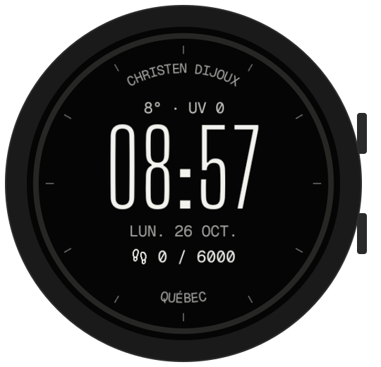
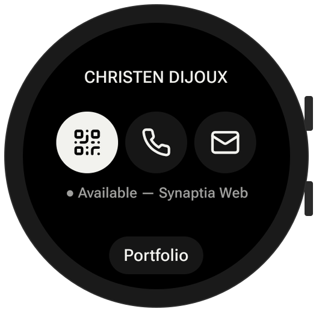
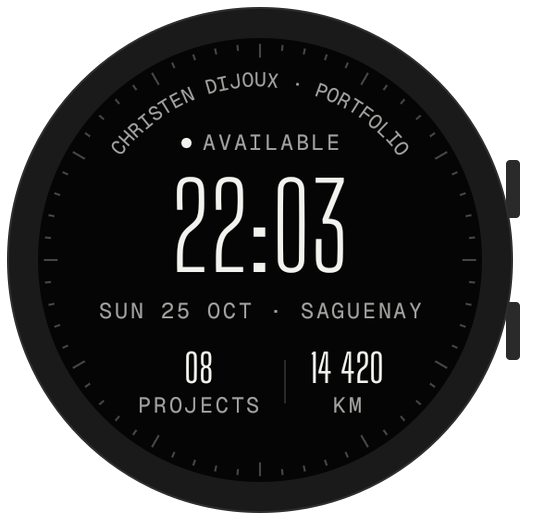
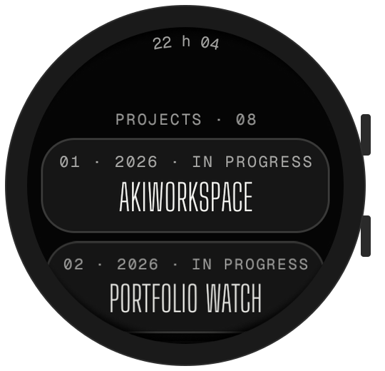
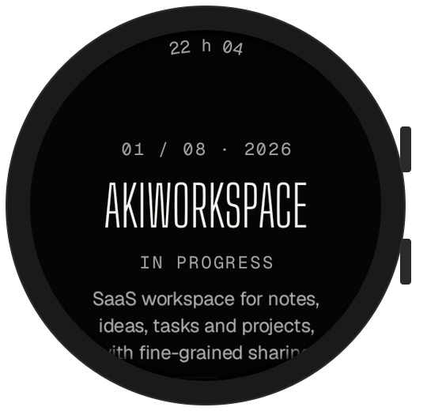
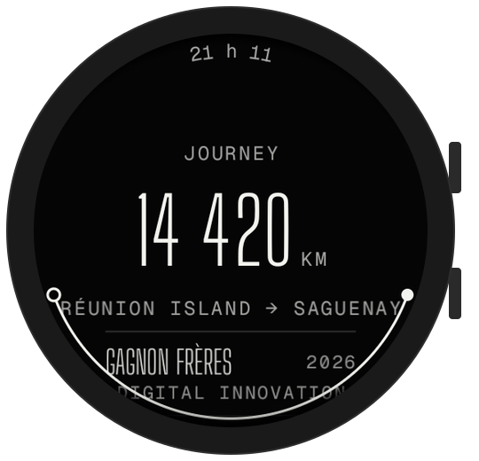
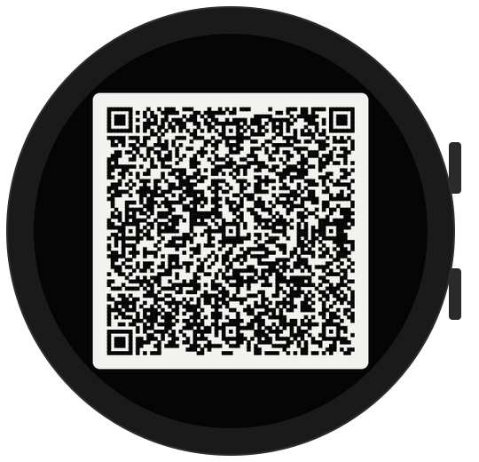
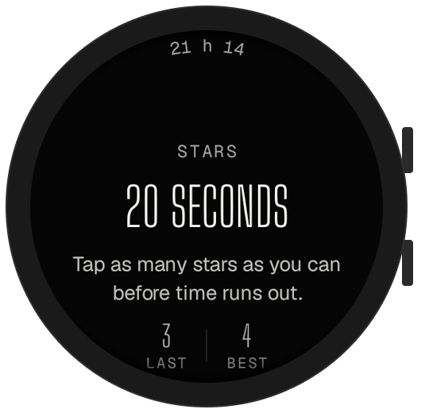
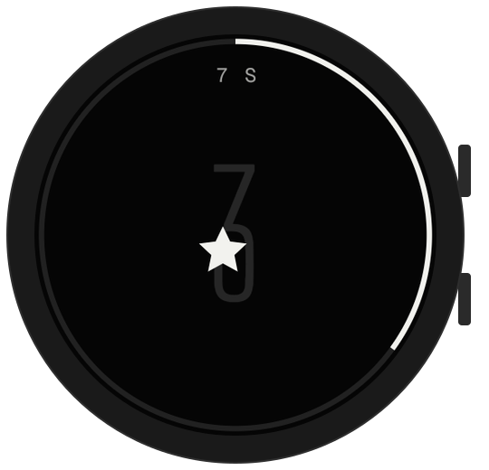

<p align="center">
  
</p>

<p align="center">
  <a href="https://github.com/Akiyo974/portfolio-watch/actions/workflows/android.yml"></a>
  <a href="https://github.com/Akiyo974/portfolio-watch/releases/latest"></a>
  
  
  
  
</p>

<p align="center">
  <a href="https://christendijoux.com"><b>christendijoux.com</b></a> ·
  <a href="#preview">Preview</a> ·
  <a href="#install">Install</a> ·
  <a href="#development">Development</a> ·
  <a href="#roadmap">Roadmap</a>
</p>

---

My [portfolio](https://christendijoux.com), redesigned for a round screen an inch and a half wide.
A **Wear OS** app built for the **Samsung Galaxy Watch**: my projects, my journey and a way to reach me, on the wrist, in three taps or less.

It carries over the website's identity — monochrome, editorial, condensed type — and adapts it to Wear OS conventions: a clock at the top that fades as you scroll, lists that follow the curve of the screen, bezel scrolling, and swipe-right to go back.

## Preview

The project has three parts that work together on the watch: a **watch face**, a **tile** and the **app**. All screenshots come from a real Samsung Galaxy Watch (Wear OS 6, 480 px); the original design mockups are in [docs/design](docs/design).

### 1. Watch face

<p align="center"></p>

A watch face in the portfolio's style, installed separately from the app (`portfolio-watch-face-*.apk`) and chosen like any other watch face. From the edge inward:

- **Ring** — fills up around the edge as you walk, toward your daily step goal.
- **CHRISTEN DIJOUX** — written along the top edge.
- **Temperature · UV index** — from the Samsung Weather app; the line disappears when no weather data is available.
- **Time and date** — the time in the site's condensed typeface, the date in the watch language.
- **Steps / goal** — today's steps and the daily goal.
- **City** — along the bottom edge: where the watch is right now, provided by the app from its approximate location.

In always-on mode, only the time, date and city remain, dimmed.

### 2. Tile

<table>
  <tr>
    <td align="center" valign="top" width="33%"><br><b>Contact card</b><br><sub>Swipe left from the watch face. Shows availability and three buttons: <b>QR</b> opens the business card, <b>call</b> and <b>email</b> start right away. <b>Portfolio</b> opens the app.</sub></td>
  </tr>
</table>

### 3. The app

**Getting around**

<table>
  <tr>
    <td align="center" valign="top" width="33%"><br><b>Home screen</b><br><sub>Opens when you launch the app: time, date, availability, number of projects and kilometres travelled. Tap anywhere to open the menu.</sub></td>
    <td align="center" valign="top" width="33%"><br><b>Menu</b><br><sub>The FR / EN switch at the top, then the four sections: Projects, Journey, Contact and Stars. Swipe right to go back, anywhere in the app.</sub></td>
  </tr>
</table>

**The portfolio**

<table>
  <tr>
    <td align="center" valign="top" width="33%"><br><b>Projects</b><br><sub>The eight portfolio projects with their number, year and status. Tap one to open it.</sub></td>
    <td align="center" valign="top" width="33%"><br><b>Case study</b><br><sub>A short summary of the project and its technologies. <b>Open on phone</b> shows the full case study on the paired phone.</sub></td>
    <td align="center" valign="top" width="33%"><br><b>Journey</b><br><sub>14,420 km from Réunion Island to Saguenay, drawn as a flight path, followed by recent roles.</sub></td>
  </tr>
</table>

**Getting in touch**

<table>
  <tr>
    <td align="center" valign="top" width="33%"><br><b>Contact</b><br><sub>Email, call, LinkedIn and GitHub in one tap; calls go out from the watch when it can, otherwise from the phone. <b>My card</b> at the bottom opens the QR code.</sub></td>
    <td align="center" valign="top" width="33%"><br><b>My card</b><br><sub>A vCard business card as a QR code: point a phone camera at it to add the contact. Full brightness, and it stays on screen when the wrist is lowered. Also one tap away from the tile or the watch face.</sub></td>
  </tr>
</table>

**The easter egg**

<table>
  <tr>
    <td align="center" valign="top" width="33%"><br><b>Stars</b><br><sub>The website's hidden game: last score, best score and the <b>Play</b> button.</sub></td>
    <td align="center" valign="top" width="33%"><br><b>Playing</b><br><sub>Catch as many stars as you can in 20 seconds; the ring around the edge counts down, and every hit vibrates.</sub></td>
  </tr>
</table>

## Highlights

- **English and French** — the app follows the watch language; the FR / EN switch in the menu overrides it and is remembered (the tile and the complications follow too).
- **Complications for any watch face** — *My card* (opens the QR code) and *City* (where the watch is), usable on Samsung's watch faces as well.
- **Always-on aware** — the QR code stays scannable with the wrist lowered; the other screens switch to a quiet, nearly black clock.
- **Standalone** — no companion app needed on the phone.
- **Signed releases** — every `v*` tag publishes the app and the watch face, signed with the same key, so updates install on top without losing data.

## Install

### From a release

1. Download `portfolio-watch-v*.apk` from the [latest release](https://github.com/Akiyo974/portfolio-watch/releases/latest).
2. On the watch: *Settings → About watch → Software information*, tap **Software version** 5 times to enable developer mode.
3. *Settings → Developer options*: turn on **ADB debugging** and **Wireless debugging**, then note the IP address and ports shown.
4. From the computer, on the same Wi-Fi network:

```bash
adb pair <IP>:<PAIRING_PORT>
adb connect <IP>:<PORT>
adb install -r portfolio-watch-v0.6.0.apk
adb install -r portfolio-watch-face-v0.6.0.apk
```

`-r` updates the installed app and keeps its data. Since v0.2.0, releases are signed with the same key, so updates install on top of each other. To move from v0.1.0 (or a debug APK) to a release, uninstall the old version once (`adb uninstall com.christendijoux.watch`).

> Some Wi-Fi networks (school, office, guest) isolate devices from each other and `adb pair` fails with *protocol fault*. Connect the computer and the watch to your phone's hotspot instead.

To add the tile: long-press the watch face or swipe to the end of your tiles, tap **+**, then **Contact card**.

To use the watch face: long-press the current watch face, swipe to the end, tap **+**, then **Christen Dijoux**. On first launch after installing, the app asks once for location access: it is only used to show the current city on the watch face.

### From CI

Every push to `main` builds the app: the debug APK can be downloaded from the artifacts of the [latest build](https://github.com/Akiyo974/portfolio-watch/actions/workflows/android.yml). It is signed with a debug key that changes from one build to the next, so the app has to be uninstalled first.

## Development

### Requirements

- JDK 17
- Android SDK (platform 35) — via [Android Studio](https://developer.android.com/studio) or the command-line tools
- A Galaxy Watch on Wear OS 3+ **or** the *Wear OS Large Round* emulator

### Build and run

```bash
git clone https://github.com/Akiyo974/portfolio-watch.git
cd portfolio-watch
./gradlew assembleDebug      # APK in app/build/outputs/apk/debug/
./gradlew installDebug       # installs on the connected watch or emulator
./gradlew testDebugUnitTest  # unit tests (vCard and QR round trip)
./gradlew lintDebug          # Android static analysis
```

Without Android Studio, point to the SDK in a `local.properties` file (not versioned):

```properties
sdk.dir=C:/Users/<you>/Android/Sdk
```

### Publish a release

1. Bump `versionCode` and `versionName` in `app/build.gradle.kts`, and date the matching section of the [CHANGELOG](CHANGELOG.md).
2. Once it is on `main`, push the version tag:

```bash
git tag v0.3.0
git push origin v0.3.0
```

The [Release](.github/workflows/release.yml) workflow checks that the tag matches `versionName`, builds the signed APK, then publishes the release with notes taken from the CHANGELOG.

Signing uses a fixed PKCS12 key (alias `portfolio-watch`), never versioned, provided by two repository secrets (*Settings → Secrets and variables → Actions*):

| Secret | Content |
|---|---|
| `SIGNING_KEYSTORE_BASE64` | The `.p12` file, base64-encoded |
| `SIGNING_PASSWORD` | Its password |

To sign locally, set `SIGNING_STORE_FILE`, `SIGNING_STORE_PASSWORD`, `SIGNING_KEY_ALIAS` and `SIGNING_KEY_PASSWORD` before `./gradlew assembleRelease`. Without them, the release APK is built unsigned.

### Tech stack

| Layer | Choice |
|---|---|
| Language | Kotlin 2.1 |
| UI | Jetpack Compose for Wear OS 1.4 (`compose-material`, `compose-foundation`) |
| Navigation | `SwipeDismissableNavHost`: swipe right or back button |
| Lists | `ScalingLazyColumn`, bezel scrolling, curved `PositionIndicator` |
| Open on phone | `RemoteActivityHelper` (`androidx.wear:wear-remote-interactions`) |
| Business card | vCard QR code generated on the watch ([ZXing](https://github.com/zxing/zxing)) |
| Tile | Jetpack Tiles + ProtoLayout Material (`androidx.wear.tiles`) |
| Watch face | Watch Face Format v1 (declarative XML, no code), checked in CI by Google's `wff-validator` |
| Complication | `androidx.wear.watchface:watchface-complications-data-source` |
| Fonts | Big Shoulders Display, Geist, Geist Mono — bundled variable fonts |
| Build | Gradle 8.11 · AGP 8.7 · JDK 17 · GitHub Actions |
| Target | Wear OS 3+ (API 30 and up), Galaxy Watch 4 and newer |

### Structure

```text
portfolio-watch/
├── app/src/main/
│   ├── java/com/christendijoux/watch/
│   │   ├── MainActivity.kt           # Entry point, app language, tile shortcuts
│   │   ├── data/Portfolio.kt         # Projects, journey, links (from the website)
│   │   ├── data/ContactCard.kt       # vCard business card and QR code
│   │   ├── tile/ContactTileService.kt # Tile: availability, QR, call, email
│   │   ├── complication/             # "My card" and "City" complications
│   │   ├── util/                     # Open on phone, clock, app language
│   │   └── ui/
│   │       ├── WearApp.kt            # Navigation between screens
│   │       ├── theme/Theme.kt        # Colors, fonts, text styles
│   │       ├── components/           # Labels, buttons, icons
│   │       └── screens/              # Home, Menu, Projects, Project, Journey, Contact, QR, Game
│   └── res/                          # Fonts, icons, theme, EN (values) and FR (values-fr) strings
├── app/src/test/                     # Unit tests (business card, QR code)
├── watchface/src/main/res/           # Watch face: raw/watchface.xml, static fonts, preview
├── .github/workflows/android.yml     # Build, tests, lint and APK on every push
├── .github/workflows/release.yml     # Signed APK and release on every v* tag
├── docs/
│   ├── screens/                      # App screenshots
│   └── design/                       # Design mockups
└── third_party/fonts/                # Font licenses (OFL)
```

### Design

| | |
|---|---|
| **Colors** | Ink `#050505` · Paper `#F2F2EE` · Lines at 16–28 % opacity |
| **Typefaces** | [Big Shoulders Display](https://fonts.google.com/specimen/Big+Shoulders+Display) (titles) · [Geist](https://vercel.com/font) (body) · Geist Mono (labels) |
| **Principles** | Content inside the central safe zone, touch targets ≥ 48 dp, text that follows the curve of the screen |

## Roadmap

- [x] Screen mockups (round format)
- [x] Wear OS app: home, menu, projects, case study, journey, contact, game
- [x] Links open on the phone
- [x] Continuous integration (build, lint, APK)
- [x] Business card QR code
- [x] English version and in-app FR / EN switch
- [x] Signed releases published automatically
- [x] Wear OS tile (availability, QR card, call, email)
- [x] Tested on a real Galaxy Watch
- [x] QR code kept visible in always-on mode
- [x] Unit tests for the business card, run by CI
- [ ] Projects loaded from the website instead of hard-coded
- [x] Installable watch face (Watch Face Format) and "My card" complication
- [ ] Google Play Store release

Changes are detailed in the [CHANGELOG](CHANGELOG.md) (in French).

## Links

- Web portfolio: [christendijoux.com](https://christendijoux.com) — code: [Akiyo974/portfolio](https://github.com/Akiyo974/portfolio)
- LinkedIn: [christen-dijoux](https://www.linkedin.com/in/christen-dijoux)

## License

Code released under the [MIT](LICENSE) license. © 2026 Christen Dijoux.

Fonts under the [SIL Open Font License](third_party/fonts): Big Shoulders Display (The Big Shoulders Project Authors), Geist and Geist Mono (The Geist Project Authors). Icons based on [Lucide](https://lucide.dev) (ISC).
